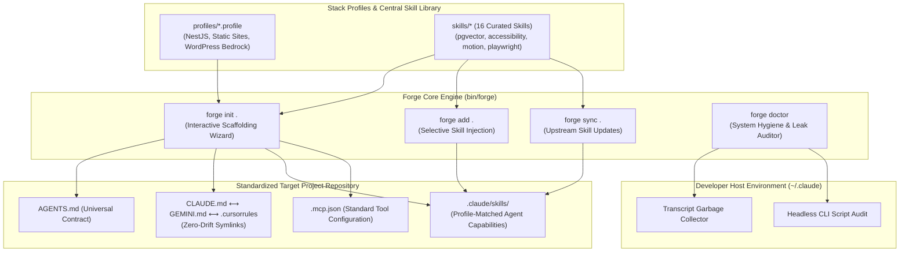

# agent-skills-kit 🛠️

<p align="center">
  <br />
  <a href="https://github.com/umairmsm/agent-skills-kit/actions/workflows/ci.yml"></a>
  <a href="https://opensource.org/licenses/MIT"></a>
  <a href="https://github.com/umairmsm/agent-skills-kit/issues"></a>
  <a href="#4-skill-library-inventory"></a>
</p>

<p align="center">
  Crafted with receipts by <b><a href="https://github.com/umairmsm">Umair (@umairmsm)</a></b><br>
  <i>Applied Homelab AI Practitioner · Bare-Metal Multi-Agent Architectures</i>
</p>

<p align="center">
  <b>Stack-based skill library and universal context scaffolder</b> for Claude Code, Antigravity, and AI teams.<br />
  Your stack rules, proven architectural skills, and session hygiene, wired into your agents in seconds.
</p>
<p align="center">
  面向 Claude Code 与 Antigravity 的全栈智能体脚手架与技能库，<br />
  一键注入架构规则、专业技能与会话卫士，彻底终结多智能体规则漂移。
</p>

<p align="center">
  
</p>

## Features

- **Universal Contracts:** Scaffolds single-source-of-truth `AGENTS.md` with zero-drift symlinks (`CLAUDE.md`, `GEMINI.md`, `.cursorrules`) across all AI coding assistants.
- **16 Battle-Tested Skills:** Instantly injects production skills into `.claude/skills/` (PostgreSQL/pgvector, WCAG 2.2 accessibility, motion design, Playwright verification).
- **System Hygiene Doctor:** `forge doctor` catches headless CLI session persistence leaks, cleans zero-message transcripts, and protects project memories.
- **Stack-Specific Profiles:** Pre-configured architectures for NestJS + PostgreSQL, Static Sites, WordPress Bedrock, with single-command extensible profiles.
- **Token Optimization:** Curated skills guide agents to write clean code without hallucinating deprecated libraries or wasting token context budgets.
- **Works Everywhere:** Pure bash and POSIX sh with zero runtime dependencies across macOS, Linux, Windows (WSL2), and BSD.

---

## 👨‍💻 Maintainer Field Notes: Why I Built This

> *"When running unattended autonomous coding agents across multiple local projects on my homelab runner, I kept hitting the same two problems: different AI tools (Claude Code, Cursor, Antigravity) drifted out of sync with conflicting rules, and background runs filled my machine with thousands of abandoned, zero-message CLI session transcripts. I built `agent-skills-kit` to enforce a single universal contract (`AGENTS.md`), inject curated stack skills, and keep my developer environment in top hygiene."*  
> — **Umair ([@umairmsm](https://github.com/umairmsm))**, *Applied Homelab AI Practitioner*

👉 *Read the full architectural breakdown on [pirateclasses.com](https://pirateclasses.com).*

---

## 1. The Problem: Rule Drift & Context Bloat

When engineering teams use multiple AI coding tools across different repositories, their workflows break in subtle ways:
1. **Rule Drift Across Tools**: Developers configure `.cursorrules` in one repo, `CLAUDE.md` in another, and forget `AGENTS.md`. Different AI assistants receive conflicting constraints and write incompatible code.
2. **Generic AI Hallucinations**: Without stack-tailored architectural patterns and verification skills, models guess library versions, invent nonexistent methods, and skip accessibility checks.
3. **Session & Transcript Bloat**: Headless automation scripts spawn hundreds of abandoned CLI transcripts in `~/.claude/projects/`, silently wasting disk space and token context budgets.

### The Contrast Matrix

| The Fragile Manual Way ❌ | The `agent-skills-kit` Scaffolding Way ✅ |
|---|---|
| **Multi-Tool Rule Drift**: Maintaining separate instructions for Cursor, Claude Code, and Antigravity leads to out-of-sync agent behavior. | **Universal Contract**: Single `AGENTS.md` source-of-truth with zero-drift symlinks (`CLAUDE.md`, `GEMINI.md`, `.cursorrules`). |
| **Generic Hallucinations**: Agents guess architecture, writing insecure APIs or untested database queries. | **Curated Production Skills**: 16 battle-tested skills injected directly into `.claude/skills/` tailored to the exact stack. |
| **Hidden Transcript Bloat**: Headless background scripts create thousands of zero-message JSONL files. | **Automated System Doctor**: `forge doctor` catches missing `--no-session-persistence` flags and auto-cleans empty transcripts. |
| **Manual Project Setup**: Copying linters, test harnesses, and agent conventions takes hours per repo. | **5-Second Interactive Wizard**: `forge init` scaffolds complete agent architecture, MCP configs, and stack skills instantly. |

---

## 2. Architecture: Universal Multi-Agent Scaffolding & Skill Hub



---

## 3. 5-Minute Quickstart

### Installation

Clone the repository and add `bin/` to your PATH (or run directly):

```bash
git clone https://github.com/umairmsm/agent-skills-kit.git ~/.forge
export PATH="$HOME/.forge/bin:$PATH"
```

### Inspect Available Profiles

Run <kbd>forge list</kbd> to inspect pre-configured stack profiles:

```bash
forge list
```

Output:
```text
╭────────────────────────────────────────────────────────────────────────────╮
│  🔨 FORGE PROFILES  · Available Agent Context Stacks                       │
╰────────────────────────────────────────────────────────────────────────────╯

  ╭─ nest-pg-static (NestJS + Postgres/pgvector + static export)──────────────╮
  │  Database-backed NestJS backend that renders a static HTML site.          │
  │  📦 Skills: nest-api-patterns · pg-pgvector-ops · docker-stack-dev        │
  │  🛠️  Tools:  node>=20 · docker · docker-compose · rsync                   │
  ╰───────────────────────────────────────────────────────────────────────────╯

  ╭─ static-site (Static site (no backend))───────────────────────────────────╮
  │  Hand-built or generator-produced static HTML/CSS/JS with no runtime.     │
  │  📦 Skills: static-export-build · playwright-verify · web-a11y-wizard     │
  │  🛠️  Tools:  node>=20 · rsync · openssh-client                            │
  ╰───────────────────────────────────────────────────────────────────────────╯

  ╭─ wordpress-bedrock (WordPress (Bedrock + DDEV))───────────────────────────╮
  │  Composer-managed WordPress with Bedrock layout, DDEV local dev, WP-CLI.  │
  │  📦 Skills: wordpress-modern · wp-performance · wp-plugin-development     │
  │  🛠️  Tools:  php>=8.2 · composer · ddev · wp-cli · rsync                  │
  ╰───────────────────────────────────────────────────────────────────────────╯
```

### Scaffold a Project

Navigate to any project root and run <kbd>forge init .</kbd>:

```bash
forge init .
```

The interactive wizard asks 3 quick questions:
1. **Stack profile** (e.g. `nest-pg-static`, `static-site`, `wordpress-bedrock`)
2. **Project name**
3. **Production URL and deploy targets**

Forge immediately installs:
- `.claude/skills/` containing the exact skills your stack requires
- `AGENTS.md` tailored to your stack with build/test/deploy conventions
- `GEMINI.md -> AGENTS.md` and `CLAUDE.md -> AGENTS.md` symlinks
- `.mcp.json` template

### Add Individual Skills

Already have an existing project and just need one specific capability?

```bash
forge add web-accessibility-wizard .
forge add pg-pgvector-ops .
```

### Sync Updates

Keep installed skills in sync with the central library without overwriting custom project edits:

```bash
forge sync .
```

### Run System Doctor

Run <kbd>forge doctor</kbd> to check your development environment for Claude Code session hygiene:

```bash
forge doctor
```

```text
╭────────────────────────────────────────────────────────────────────────────╮
│  🩺 FORGE DOCTOR  · Claude Code & Session Hygiene Auditor                  │
╰────────────────────────────────────────────────────────────────────────────╯

   PASS  cleanupPeriodDays: active (45 days)
   PASS  project memories: 22 directories preserved (contain memory/)
   WARN  headless script: pmo-standup.sh:62 missing --no-session-persistence
   FAIL  transcript leak: zero-message transcript found
```

---

## 4. Skill Library Inventory

Forge bundles 16 production-tested skills ready for instant injection:

| Skill | Category | Description | Origin / Attribution |
|---|---|---|---|
| `agent-interop` | Architecture | Multi-agent alignment and pointer patterns | Native |
| `context-budget` | Token Optimization | Claude Code session token auditor | [ECC](https://github.com/affaan-m/ECC) |
| `deploy-static-cpanel` | DevOps | Pre-flight validation and safe rsync deployment | Native |
| `design-motion-principles` | Frontend / UI | Motion design framework & AI-slop animation auditor | Distillation of techniques by Emil Kowalski, Jakub Krehel, Jhey Tompkins |
| `docker-stack-dev` | DevOps | Containerized local dev stacks | Native |
| `nest-api-patterns` | Backend | NestJS architecture, DTO validation, and queues | Native |
| `pg-pgvector-ops` | Database | PostgreSQL schema design, indexing, and vector embeddings | Native |
| `playwright-verify` | QA / Testing | Browser automation and visual snapshot verification | Native |
| `static-export-build` | Frontend | SSG build optimization and cache management | Native |
| `ux-researcher` | Product / Design | Usability testing protocols and interview personas | Native |
| `web-accessibility-wizard` | Accessibility | Guided WCAG 2.2 accessibility auditor | [W3C WCAG 2.2](https://www.w3.org/TR/WCAG22/) |
| `wordpress-modern` | WordPress | Modern WP 6.8+ asset loading & speculative prefetching | [mikkelkrogsholm/wp-plugins](https://github.com/mikkelkrogsholm) |
| `wp-performance` | WordPress | Query and cache profiling | Native |
| `wp-performance-review` | WordPress | Systematic PHP code-level performance audits | Native |
| `wp-plugin-development` | WordPress | Object-oriented plugin patterns | Native |
| `wp-wpcli-and-ops` | WordPress | WP-CLI automation and database exports | Native |

---

## 5. System Hygiene: The Claude Code Doctor

Automated background scripts and headless invocations often degrade developer machines over time. `forge doctor` performs continuous environmental hygiene:

1. **Catches Headless Session Leaks**: Scans shell scripts for headless `claude -p` calls missing the mandatory `--no-session-persistence` flag.
2. **Purges Zero-Message Transcript Bloat**: Identifies and cleans empty `.jsonl` session files in `~/.claude/projects/` that bloat disk storage and confuse session pickers.
3. **Protects Project Memories**: Verifies that genuine agent project memory directories (`memory/`) remain untouched and safe during maintenance.
4. **Validates Retention Policies**: Verifies that your Claude Code `cleanupPeriodDays` config is active and properly tuned.

---

## 6. Community & Good First Issues

We actively welcome community contributions! Check out our live [Good First Issues on GitHub](https://github.com/umairmsm/agent-skills-kit/issues):

| Issue | Category | Description |
|---|---|---|
| [#1](https://github.com/umairmsm/agent-skills-kit/issues/1) | `profile/fastapi` | **FastAPI + Tortoise ORM + Redis Profile**: Add stack profile and verification tests for Python modern async APIs. |
| [#2](https://github.com/umairmsm/agent-skills-kit/issues/2) | `profile/go-chi` | **Go + Chi Router + Postgres Profile**: Add lightweight Go microservice profile with Docker Compose support. |
| [#3](https://github.com/umairmsm/agent-skills-kit/issues/3) | `skill/security-audit` | **OWASP Top 10 Security Skill**: Add automated pre-commit security review skill for dependencies and headers. |
| [#4](https://github.com/umairmsm/agent-skills-kit/issues/4) | `doctor/gemini-check` | **Antigravity / Gemini Configuration Auditor**: Add doctor checks for Antigravity workspace config and symlink integrity. |
| [#5](https://github.com/umairmsm/agent-skills-kit/issues/5) | `profile/sveltekit` | **SvelteKit + Tailwind CSS Profile**: Add modern reactive frontend profile with Playwright test scaffolding. |

Please see [CONTRIBUTING.md](CONTRIBUTING.md) and our [Code of Conduct](CODE_OF_CONDUCT.md).

---

## 7. License & Third-Party Notice

- agent-skills-kit is released under the [MIT License](LICENSE). Copyright (c) 2026 [umairmsm](https://github.com/umairmsm).
- Skills derived from community works preserve upstream licenses and author attributions (see [CHANGELOG.md](CHANGELOG.md) and individual `SKILL.md` frontmatter).
